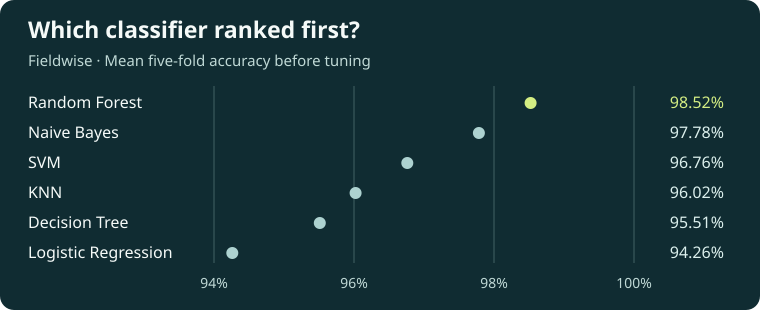

# Imran Ali

**Data science student at DUET Karachi · Applied AI and data visualization**

I build tools for questions close to home. Which crops resemble the conditions measured in a field? How do reported road crashes vary across Pakistan’s provinces? I study data science at Dawood University of Engineering and Technology, and my background in graphic design shapes how I present the answers.

[Interactive data science portfolio](https://imran-data-studio.warmessay64.chatgpt.site) · Owner-only preview

## Featured project · Fieldwise

I built a Streamlit app that takes seven soil and climate readings and ranks three crop matches. You can open **Why this crop?** to compare each reading with the typical range for the top match.

I compared six classifiers on 2,200 examples spanning 22 crops. After tuning, the random forest correctly classified **434 of 440 held-out examples (98.64%)**. How well these recommendations transfer to new farms is still an open question.

[Explore Fieldwise](https://github.com/imranali-ds/fieldwise-crop-recommendation) · [Read the training notebook](https://github.com/imranali-ds/fieldwise-crop-recommendation/blob/main/training_notebook.ipynb) · [See the Streamlit app code](https://github.com/imranali-ds/fieldwise-crop-recommendation/blob/main/app.py)

## More of my work

- **One Soil Test** — I tested whether weather readings could guide the choice of a single soil measurement. An adaptive policy recovered 17 more crop labels than a fixed policy on 2,200 held-out predictions. [Explore the experiment and reproduce the results](https://github.com/imranali-ds/one-soil-test)

- **Pakistan road safety dashboard** — I used Power BI to compare reported crashes, deaths, and injuries by province and track how each measure changed over time.
- **AgriFollow** — A crop-monitoring prototype for recording symptoms and comparing photos of the same plant over time. [View the project](https://github.com/imranali-ds/agri_follow)
- **Student records** — My first Python notebook on GitHub. It stores names and marks in dictionaries and identifies the highest score. [View the notebook project](https://github.com/imranali-ds/student-record-system-notebook)

## Skills I use

| Area | Tools and methods |
| --- | --- |
| Data analysis | Python, pandas, NumPy, exploratory analysis, missing-value handling |
| Machine learning | scikit-learn, classification, clustering, cross-validation, model evaluation |
| Visualization and apps | Power BI, Matplotlib, Seaborn, Streamlit, Jupyter |

[Connect with me on LinkedIn](https://www.linkedin.com/in/imranalisahito/)
